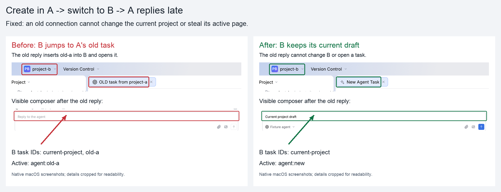

# Agent task reply ownership: verification evidence

Start a task (or fork a conversation) in project A, then switch projects before its reply arrives. Before the fix, the reply can insert A's task into B and switch away from B's New Agent Task page. The fix ignores completions from the old Agent connection, including errors and the continuation after an asynchronous Home close.



The screenshot boxes/arrows and captions were added with code. The raw full screenshots and inspected state are included. The current draft was stored before the fix but its page was replaced by the old task; the comparison does not claim its text was deleted.

`native-sequence.gif` is a numbered sequence of native screenshots: request in A, switch to B, release A's delayed reply. It shows the same scenario before and after.

Native validation uses the real macOS Tauri/WebKit workbench and native project open/close. Agent replies are controlled local fixtures, not calls to an external provider. The frontend is based on main `0fd8389b`; the already-built isolated Tauri host is from `a46f1874` (Agent backend unchanged between these commits). Windows/Linux native runs were not performed.

Native matrix: 18 cases, before 8 pass / 10 fail, after 18 pass / 0 fail. It covers create/fork, success/error, A to B, A to B to A, closing and reopening A, same-project controls and a project change while Home closes.

Unit regression: 122 new cases, before 38 pass / 84 fail, after 122 pass. With the 105 existing composer submission cases: 227 pass. An independent subagent reviewed the final files and independently reran those 227 cases on latest main.

Full frontend assertions: 11,859 pass / 6 skipped, zero assertion failures. The command exits 1 for an unrelated existing `SourceDialog.test.tsx` SSH tunnel rejection (`Cannot read properties of undefined (reading 'invoke')`). A separate run with the Agent change reverted to main reproduces the same error (4 assertions pass, exit 1).

Other final checks are recorded in `validation-summary.json` when complete.

To rerun the native matrix, copy `native-run.mjs` and `native-init.js` into a scratch directory, launch the task worktree with `pnpm dev:app`, and run:

```sh
OPENIDEA_EVIDENCE_DIR=/path/to/scratch node /path/to/scratch/native-run.mjs before
# Apply the fix, reload the native webview, then run the same matrix:
OPENIDEA_EVIDENCE_DIR=/path/to/scratch node /path/to/scratch/native-run.mjs after
```

The runner discovers the bridge from `scripts/dev-status.ts` and verifies the worktree app identifier. Use a disposable verification worktree: it opens local fixture projects and replaces only Agent command replies in that dev webview.

Latest Agent browser regression: 64/64 pass across 7 specs, including the 18 new project ownership cases, prior draft submission, docking, approvals, questions, scrolling and markdown flows. Typecheck, lint, format and knip exit0.

`pnpm build` exits0, including Safari16 startup API and bundle syntax checks. All task checks are complete; the sole full-suite process failure is the baseline SSH test rejection described above.
